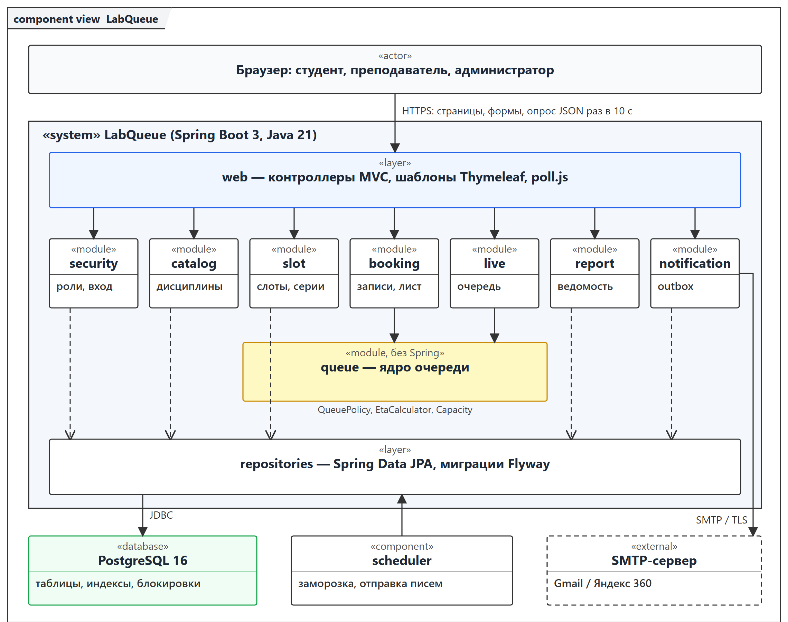
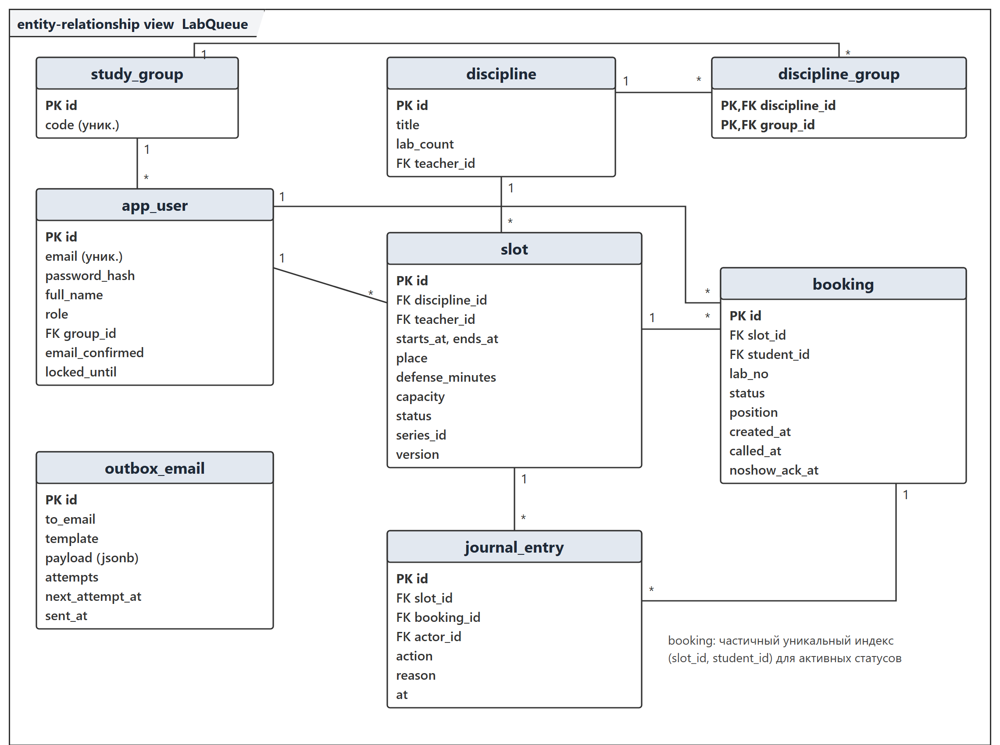
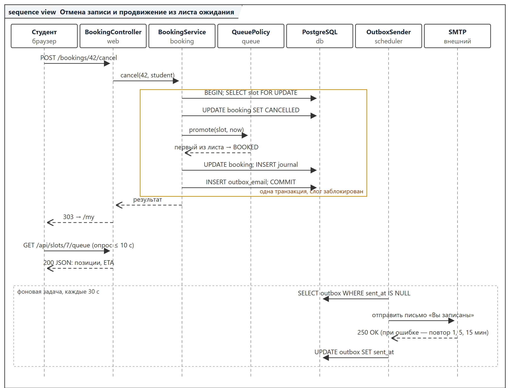
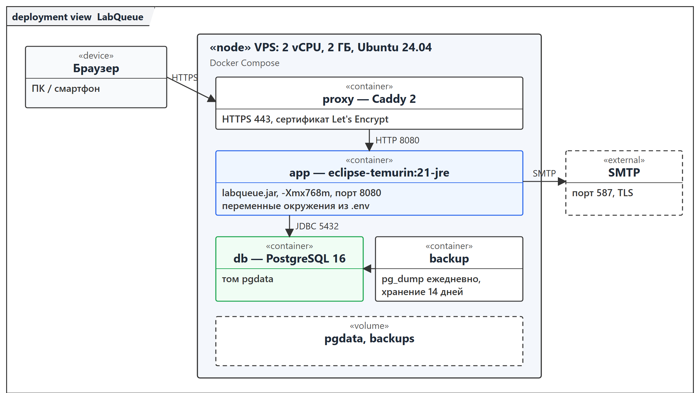

# Описание дизайна программного обеспечения

Для LabQueue — веб-приложения «Электронная очередь на защиту лабораторных
работ»

Версия 1.1


Подготовил Рудольф Н. В., гр. 450501

БГУИР, факультет КСиС, кафедра ЭВМ

04.11.2026

## Оглавление

<!-- TOC -->
* [1. Введение](#1-introduction)
  * [1.1 Назначение документа](#11-document-purpose)
  * [1.2 Область применения](#12-subject-scope)
  * [1.3 Определения, акронимы и сокращения](#13-definitions-acronyms-and-abbreviations)
  * [1.4 Ссылки](#14-references)
  * [1.5 Обзор документа](#15-document-overview)
* [2. Обзор дизайна](#2-design-overview)
  * [2.1 Задачи стейкхолдеров](#21-stakeholder-concerns)
  * [2.2 Выбранные точки зрения](#22-selected-viewpoints)
* [3. Проектные представления](#3-design-views)
* [4. Решения](#4-decisions)
* [5. Приложения](#5-appendixes)
<!-- TOC -->

## История изменений

| Name | Date | Reason For Changes | Version |
|------|------|--------------------|---------|
| Рудольф Н. В. | 29.10.2026 | Первая редакция по SRS v0.2: архитектура, модель данных, ADR-0001…0005, бэклог с оценками (план v1) | 0.1 |
| Рудольф Н. В. | 30.10.2026 | Первый раунд с Заказчиком: обновление позиции через опрос (ADR-0003), F15 и F16 перенесены в Won't, F14 упрощено, F05 повышен до 20 (план v2) | 0.2 |
| Рудольф Н. В. | 04.11.2026 | Второй раунд: удалено F14, добавлено F18 «Ведомость защит» (представление 014, ADR-0006), в команду добавлен junior-разработчик (план v3) | 1.0 |
| Рудольф Н. В. | 04.11.2026 | Новые требования Заказчика: представление 014 расширено отчётом о записи (F19, REQ-FUNC-019), в 007, 009 и 005 добавлено правило неявки (F20, REQ-FUNC-020), план v4 | 1.1 |

---

## 1. Введение {#1-introduction}

Документ описывает архитектуру и проектные решения LabQueue 1.0 и является
продолжением спецификации требований `srs/srs-labqueue.md` (SRS v0.2). Если
SRS отвечает на вопрос, что должна делать система, то SDD отвечает на
вопрос, как она будет построена.

### 1.1 Назначение документа {#11-document-purpose}

SDD служит руководством для команды разработки: разработчика (Исполнителя) и
junior-разработчика. Документ используют при реализации модулей, ревью кода,
написании тестов и развёртывании. Заказчик использует раздел 5 для
согласования приоритетов и плана итераций. Каждое проектное представление
ссылается на требования SRS, которые оно реализует, и на решения из раздела
4.

### 1.2 Область применения {#12-subject-scope}

Документ охватывает LabQueue 1.0 целиком: веб-интерфейс, сервер приложения,
базу данных, фоновые задачи и интеграцию с почтовым сервером. Релиз 1.0
включает функции F01–F13 и F17–F20 из приложения А; функции F14–F16
исключены по итогам обсуждения с Заказчиком. Вне рамок документа —
интеграция с ИИС «БГУИР: Университет», мобильные приложения и Telegram (SRS,
приложение Г).

### 1.3 Определения, акронимы и сокращения {#13-definitions-acronyms-and-abbreviations}

| Term | Definition |
|------|------------|
| ADR | Architecture Decision Record — запись архитектурного решения (каталог `adr/labqueue`) |
| API | Application Programming Interface |
| CI | Continuous Integration — автоматическая сборка и проверка каждого изменения |
| DTO | Data Transfer Object — объект для передачи данных между слоями |
| ETA | расчётное время защиты студента (Estimated Time of Arrival) |
| Outbox | таблица исходящих писем, которые фоновая задача отправляет с повторами |
| SDD | Software Design Description — описание дизайна ПО |
| SSE | Server-Sent Events — поток событий от сервера к браузеру |
| Бэклог | упорядоченный по приоритету список функций F01–F18 (приложение А) |
| Итерация | двухнедельный отрезок разработки, после которого Заказчику показывается результат |

Остальные термины предметной области (слот, лист ожидания, заморозка и др.)
определены в SRS, раздел 1.3.

### 1.4 Ссылки {#14-references}

| Документ | Версия / дата | Расположение | Статус |
|----------|---------------|--------------|--------|
| Спецификация требований LabQueue | 0.2 | `srs/srs-labqueue.md` | нормативная |
| Модели SysML v2 | 0.2 | `srs/models/*.sysml` | нормативная |
| Шаблон SDD курса ЖЦРПО | 2026 | `sdd/sdd-template.md` | нормативная |
| Шаблон ADR (MADR 4.0) | 2026 | `adr/adr-template.md` | нормативная |
| План итераций LabQueue | 3 | `sdd/plan-labqueue.md` | справочная |
| ISO/IEC/IEEE 42010:2011 | 2011 | iso.org | справочная |
| Spring Boot 3 Reference | 3.3 | docs.spring.io | справочная |

### 1.5 Обзор документа {#15-document-overview}

Раздел 2 перечисляет стейкхолдеров и выбранные точки зрения. Раздел 3
содержит проектные представления с идентификаторами вида `NNN-название`,
раздел 4 — краткие записи архитектурных решений (полные тексты — в
`adr/labqueue`). Раздел 5 — бэклог с приоритетами и оценками, системные
требования и сводка плана итераций. Изменения вносятся через pull request и
фиксируются в «Истории изменений».

---

## 2. Обзор дизайна {#2-design-overview}

LabQueue проектируется как модульный монолит на Spring Boot 3 (ADR-0001):
одно приложение, разделённое на модули с явными зависимостями, и одна база
PostgreSQL. Страницы формируются на сервере шаблонизатором Thymeleaf
(ADR-0002). Ядро предметной области — модуль `queue` — не зависит от
веб-слоя и содержит правила вместимости, позиций, расчётного времени и
продвижения.

### 2.1 Задачи стейкхолдеров {#21-stakeholder-concerns}

| Стейкхолдер | Основные задачи | Где адресовано |
|-------------|-----------------|----------------|
| Студент | честная очередь, актуальная позиция, отсутствие двойных записей | 007, 008, 010; ADR-0003, ADR-0004 |
| Преподаватель | быстрая публикация слотов, ведение очереди одним нажатием, ведомость | 006, 007, 014; ADR-0006; отчёт о записи (F19) |
| Заказчик | срок 27.12.2026, бюджет 3718 BYN (согласован 04.11.2026) | раздел 5, план v3 |
| Разработчик | понятные модули, тестируемое ядро без Spring | 002, 003, 004, 011 |
| Junior-разработчик | изолированные задачи с понятными границами | 003, раздел 5 |
| Администратор / эксплуатация | запуск одной командой, резервные копии | 012, 013 |

### 2.2 Выбранные точки зрения {#22-selected-viewpoints}

| Точка зрения | Язык | Представления |
|--------------|------|---------------|
| Контекст | контекстная диаграмма SysML v2 | 001 |
| Композиция | диаграмма компонентов | 002 |
| Зависимости | граф зависимостей модулей | 003 |
| Логическое представление | доменная модель | 004 |
| Информация | диаграмма «сущность–связь» | 005 |
| Интерфейс | таблица HTTP-эндпоинтов | 006 |
| Взаимодействие | диаграмма последовательности | 007 |
| Алгоритм | псевдокод | 008 |
| Динамика состояний | автомат состояний SysML v2 | 009 |
| Параллелизм | описание блокировок | 010 |
| Паттерны | перечень паттернов | 011 |
| Развёртывание | диаграмма развёртывания | 012 |
| Ресурсы | таблица ресурсов | 013 |

Точки зрения «Физическое представление» и «Структура» отдельно не
используются: физическая топология совпадает с представлением 012, а
внутренняя структура компонентов достаточно описана в 002 и 003.

---

## 3. Проектные представления {#3-design-views}

- **ID:** 001-context
- **Title:** Контекст системы
- **Viewpoint:** Контекст
- **Representation:** система LabQueue взаимодействует со студентами,
  преподавателями и администратором через браузер (HTTPS) и с внешним
  SMTP-сервером. Диаграмма — `srs/images/context.png`, модель —
  `srs/models/context.sysml`.
- **More Information:** REQ-INT-001…004, CON-1…CON-4.

- **ID:** 002-components
- **Title:** Компоненты приложения
- **Viewpoint:** Композиция
- **Representation:** приложение делится на слои и модули (рисунок 1).
  Веб-слой (`web`) содержит MVC-контроллеры и шаблоны Thymeleaf. Прикладные
  модули: `security` (учётные записи, роли, блокировка), `catalog`
  (дисциплины и группы), `slot` (слоты и серии), `booking` (записи, отмена,
  перенос, лист ожидания), `queue` (ядро очереди), `live` (живая очередь и
  выдача позиции для опроса), `notification` (outbox и отправка писем),
  `report` (ведомость и выгрузка в Excel). Доступ к данным — через
  репозитории Spring Data JPA. Фоновые задачи (`scheduler`): заморозка листа
  ожидания, отправка писем, резервное копирование.



*Рисунок 1 — Диаграмма компонентов*

- **More Information:** ADR-0001, ADR-0002; REQ-MAINT-001.

- **ID:** 003-module-dependencies
- **Title:** Зависимости модулей
- **Viewpoint:** Зависимости
- **Representation:** зависимости направлены сверху вниз: `web` → прикладные
  модули → `queue` и репозитории. Модуль `queue` не зависит ни от одного
  другого модуля и ни от Spring; `booking` и `live` используют `queue`;
  `notification` получает события от `booking`, `slot` и `live` через
  `ApplicationEventPublisher`; `report` читает данные `booking` только через
  запросы на чтение. Правило проверяется тестом ArchUnit в CI.
- **More Information:** ADR-0001; REQ-MAINT-001, REQ-MAINT-002.

- **ID:** 004-domain-model
- **Title:** Доменная модель
- **Viewpoint:** Логическое представление
- **Representation:** основные сущности: `User` (роль STUDENT, TEACHER или
  ADMIN), `StudyGroup`, `Discipline` (число ЛР), `Slot` (время, место,
  длительность защиты, вместимость, статус), `Booking` (студент, номер ЛР,
  статус, позиция, время постановки), `JournalEntry`, `OutboxEmail`.
  Значимые объекты-значения: `Capacity` (вычисляется из интервала и
  длительности защиты), `Eta` (расчётное время), `QueueSnapshot`
  (неизменяемый снимок очереди слота). Классы `QueuePolicy` и
  `EtaCalculator` в модуле `queue` реализуют правила SRS и покрываются
  модульными тестами.
- **More Information:** REQ-FUNC-003, REQ-FUNC-007…011.

- **ID:** 005-data-model
- **Title:** Модель данных
- **Viewpoint:** Информация
- **Representation:** схема PostgreSQL показана на рисунке 2 и создаётся
  миграциями Flyway. Ограничения целостности: уникальный e-mail
  пользователя; частичный уникальный индекс `booking(slot_id, student_id)`
  для активных статусов — одна активная запись студента в слоте; `CHECK
  (ends_at > starts_at)` и `CHECK (defense_minutes BETWEEN 5 AND 30)` для
  слота; `booking.noshow_ack_at NOT NULL` — время, когда студент подтвердил
  предупреждение о неявке (REQ-FUNC-020); поле `version` у слота для
  оптимистичной проверки при редактировании. Время хранится в UTC
  (`timestamptz`).



*Рисунок 2 — Диаграмма «сущность–связь»*

- **More Information:** REQ-PORT-001, REQ-INST-002, REQ-OBS-001.

- **ID:** 006-http-interface
- **Title:** HTTP-интерфейс
- **Viewpoint:** Интерфейс
- **Representation:** основные эндпоинты (все, кроме входа и регистрации,
  требуют аутентификации; изменяющие запросы защищены CSRF-токеном):

| Метод и путь | Роль | Назначение | Ошибки |
|--------------|------|------------|--------|
| GET /slots?week=&discipline= | Student | список слотов недели | — |
| POST /slots/{id}/bookings | Student | запись на ЛР, обязательный параметр noShowAck | 409 мест нет или нарушено правило, 400 нет подтверждения, 403 чужая группа |
| POST /slots/{id}/waitlist | Student | постановка в лист ожидания | 409 более трёх листов |
| POST /bookings/{id}/cancel | Student | отмена записи | 409 меньше часа до начала |
| POST /bookings/{id}/move?to= | Student | атомарный перенос | 409, исходная запись сохраняется |
| GET /api/slots/{id}/queue | Student, Teacher | снимок очереди в JSON для опроса | 304 при неизменном ETag |
| POST /teacher/slots | Teacher | создание слота или серии | 400 пересечение, прошлое время |
| POST /teacher/slots/{id}/start | Teacher | начало живой очереди | 409 слот уже идёт |
| POST /teacher/bookings/{id}/mark | Teacher | Защищено / На доработку / Не явился | 409 студент не текущий или не прошло 5 мин после вызова |
| POST /teacher/bookings/{id}/call-out | Teacher | вызов вне очереди с причиной | 400 нет причины |
| GET /teacher/reports/group | Teacher | ведомость группы | 403 чужая дисциплина |
| GET /teacher/reports/group.xlsx | Teacher | выгрузка ведомости | 403 |
| GET /teacher/reports/activity?category= | Teacher | отчёт о записи по категориям | 403 чужая дисциплина |
| GET /teacher/reports/activity.xlsx | Teacher | выгрузка отчёта о записи | 403 |
| POST /admin/groups/import | Admin | импорт списка группы из .csv | 400 формат файла |

- **More Information:** ADR-0003, ADR-0006; REQ-SEC-003…004.

- **ID:** 007-cancel-and-promote
- **Title:** Отмена записи и продвижение из листа ожидания
- **Viewpoint:** Взаимодействие
- **Representation:** сценарий показан на рисунке 3. Контроллер вызывает
  `BookingService.cancel`, который в одной транзакции блокирует строку
  слота, переводит запись в CANCELLED, вызывает `QueuePolicy.promote`,
  записывает изменения в журнал и добавляет письмо в outbox. После фиксации
  транзакции браузеры получают новый снимок очереди при следующем опросе (не
  позже 10 с), а фоновая задача отправляет письмо. Путь отказа: если SMTP
  недоступен, письмо остаётся в outbox и отправляется повторно, отмена при
  этом уже выполнена.



*Рисунок 3 — Диаграмма последовательности*

- **More Information:** ADR-0004, ADR-0005; REQ-FUNC-008, REQ-FUNC-010,
  REQ-REL-002. Неявка (REQ-FUNC-020) обрабатывается так же: отметка «Не
  явился» доступна через 5 минут после `called_at`, запись переходит в
  NO_SHOW без возврата в очередь, письмо об аннулировании ставится в outbox.

- **ID:** 008-queue-algorithms
- **Title:** Алгоритмы продвижения и расчётного времени
- **Viewpoint:** Алгоритм
- **Representation:** продвижение (выполняется внутри транзакции с
  заблокированным слотом):

```
promote(slot, now):
    if slot.startsAt - now <= 30 min: return            // заморожено
    while activeBookings(slot) < slot.capacity:
        next = first waitlisted by createdAt
        if next == null: return
        next.status = BOOKED; next.position = maxPosition(slot) + 1
        journal(PROMOTED, next); outbox(PROMOTED_EMAIL, next.student)
```

Расчётное время: для слота, который ещё не начат, `eta(p) = startsAt + (p -
1) * defense`; для идущего слота `eta(p) = max(now, calledAt(current)) + (p
- pos(current)) * defense`, где позиции отменённых записей пропускаются.
Сложность обоих алгоритмов — O(n) по числу записей слота (не более 48).
- **More Information:** REQ-FUNC-010, REQ-FUNC-011; тесты
  `WaitlistPromotionTest`, `EtaCalculatorTest`.

- **ID:** 009-booking-states
- **Title:** Состояния записи
- **Viewpoint:** Динамика состояний
- **Representation:** статус записи меняется по автомату `BookingState`
  (`srs/models/booking.sysml`, `srs/images/booking-states.png`). Статусы
  хранятся в столбце `booking.status`; недопустимые переходы отклоняются
  методом `Booking.transitionTo`, который проверяет таблицу разрешённых
  переходов. Переход в NO_SHOW разрешён только если с момента вызова прошло
  не менее 5 минут (REQ-FUNC-020).
- **More Information:** REQ-FUNC-007…012, REQ-FUNC-016.

- **ID:** 010-concurrency
- **Title:** Конкурентная запись
- **Viewpoint:** Параллелизм
- **Representation:** все операции, меняющие состав очереди слота (запись,
  отмена, перенос, продвижение, отметки преподавателя), выполняются в
  транзакции, которая начинается с `SELECT … FROM slot WHERE id = ? FOR
  UPDATE`. Поэтому изменения одного слота выполняются строго
  последовательно, а разные слоты обрабатываются параллельно. Перенос
  блокирует оба слота в порядке возрастания `id`, чтобы исключить взаимную
  блокировку. Частичный уникальный индекс защищает от повторной записи даже
  при ошибке в коде.
- **More Information:** ADR-0004; REQ-REL-001, тест `ConcurrentBookingTest`
  (50 параллельных запросов → одна запись).

- **ID:** 011-patterns
- **Title:** Применённые паттерны
- **Viewpoint:** Паттерны
- **Representation:** слоистая архитектура (web → service → repository);
  Domain Model для правил очереди; Repository (Spring Data JPA);
  Transactional Outbox для писем; Observer через события Spring
  (`BookingChanged`, `SlotCancelled`); Strategy для отметок результата
  защиты; Template Method для выгрузки отчётов.
- **More Information:** ADR-0001, ADR-0005.

- **ID:** 012-deployment
- **Title:** Развёртывание
- **Viewpoint:** Развёртывание
- **Representation:** один виртуальный сервер (2 vCPU, 2 ГБ ОЗУ) с Docker
  Compose: контейнер `proxy` (Caddy, HTTPS и сертификат Let's Encrypt),
  контейнер `app` (Java 21, Spring Boot), контейнер `db` (PostgreSQL 16, том
  `pgdata`), контейнер `backup` (ежедневный `pg_dump`, хранение 14 дней).
  Внешний сервис — SMTP-сервер (рисунок 4). Настройки передаются переменными
  окружения, пример — `.env.example`.



*Рисунок 4 — Диаграмма развёртывания*

- **More Information:** REQ-INST-001, REQ-AVAIL-002, REQ-PORT-001, DEP-1,
  DEP-2.

- **ID:** 013-resources
- **Title:** Ограниченные ресурсы
- **Viewpoint:** Ресурсы
- **Representation:**

| Ресурс | Ограничение | Управление |
|--------|-------------|------------|
| Соединения с БД | пул HikariCP, 10 соединений | время ожидания 5 с, транзакции очереди короткие |
| Потоки Tomcat | 200 | хватает для 200 пользователей (REQ-PERF-001) |
| Запросы опроса | до 60 клиентов на слот раз в 10 с | ответ 304 по ETag без запроса к БД из кэша снимка |
| Отправка писем | лимит SMTP-провайдера | не более 20 писем в минуту, повторы через 1, 5 и 15 мин |
| Память JVM | 768 МБ | `-Xmx768m` в контейнере |

- **More Information:** REQ-PERF-001…002, REQ-REL-002.

- **ID:** 014-teacher-reports
- **Title:** Ведомость защит и отчёт о записи
- **Viewpoint:** Композиция, Интерфейс
- **Representation:** модуль `report` строит два отчёта для преподавателя
  дисциплины. Ведомость «студенты × ЛР» формируется одним агрегирующим
  запросом по последней записи каждого студента на каждую ЛР. Отчёт о записи
  относит каждого студента группы к категориям «Не записывались»,
  «Записаны», «В листе ожидания», «Неявки» за выбранный период и считает
  итоги (записей, защищено, на доработку, неявок); категория «Не
  записывались» вычисляется как разность списка группы и множества студентов
  с записями (`NOT EXISTS`). Оба отчёта показываются на экране
  `/teacher/reports` (две вкладки) и выгружаются в `.xlsx` библиотекой
  Apache POI.
- **More Information:** F18 добавлено во втором раунде согласования, F19 — по запросу Заказчика 04.11.2026; ADR-0006; REQ-FUNC-018,
  REQ-FUNC-019; макет — `srs/images/ui-teacher-reports.png`.

---

## 4. Решения {#4-decisions}

Полные тексты решений по шаблону MADR находятся в каталоге `adr/labqueue`.

- **ID:** ADR-0001
- **Title:** Модульный монолит на Spring Boot
- **Context:** нужна система для одного учебного заведения с небольшой
  нагрузкой, разрабатываемая одним разработчиком за семестр.
- **Options:** модульный монолит; микросервисы; отдельные frontend (SPA) и
  backend.
- **Outcome:** выбран модульный монолит, потому что он проще в разработке,
  тестировании и развёртывании, а границы модулей сохраняют возможность
  выделить сервисы позже.

- **ID:** ADR-0002
- **Title:** Серверный рендеринг на Thymeleaf
- **Context:** интерфейс должен работать в браузере без установки ПО, а у
  команды нет отдельного frontend-разработчика.
- **Options:** Thymeleaf; React SPA; Vue SPA.
- **Outcome:** выбран Thymeleaf, потому что не требует отдельной сборки
  клиента и второго языка разработки (CON-2).

- **ID:** ADR-0003
- **Title:** Обновление позиции в очереди периодическим опросом
- **Context:** студент должен видеть изменения очереди не позже 10 с без
  перезагрузки страницы; бюджет времени ограничен.
- **Options:** периодический опрос раз в 10 с; Server-Sent Events;
  WebSocket.
- **Outcome:** выбран опрос, потому что он стоит 4 ч вместо 12 ч и не
  зависит от настроек прокси. Решение принято в первом раунде согласования;
  SSE — кандидат на версию 1.1.

- **ID:** ADR-0004
- **Title:** Пессимистическая блокировка слота при записи
- **Context:** при открытии записи десятки студентов одновременно претендуют
  на последние места (REQ-REL-001).
- **Options:** `SELECT … FOR UPDATE` по слоту; оптимистичная блокировка с
  повтором; уровень изоляции SERIALIZABLE.
- **Outcome:** выбрана блокировка строки слота, потому что она проста,
  детерминирована и не требует повторов на стороне клиента.

- **ID:** ADR-0005
- **Title:** Отправка писем через transactional outbox
- **Context:** письмо не должно теряться и не должно блокировать запись при
  недоступном SMTP (REQ-REL-002).
- **Options:** синхронная отправка; outbox и фоновая задача; брокер
  сообщений.
- **Outcome:** выбран outbox, потому что письмо фиксируется в той же
  транзакции, что и изменение очереди, а брокер избыточен для одного
  сервера.

- **ID:** ADR-0006
- **Title:** Выгрузка ведомости в .xlsx средствами Apache POI
- **Context:** во втором раунде Заказчик добавил ведомость с выгрузкой в
  Excel (F18).
- **Options:** Apache POI; выгрузка .csv; генерация PDF.
- **Outcome:** выбран Apache POI, потому что Заказчику нужен именно Excel с
  форматированием, а библиотека распространяется по лицензии Apache 2.0
  (REQ-COMP-002).

---

## 5. Приложения {#5-appendixes}

**Приложение А. Бэклог: системные требования и приоритеты функционала**

Приоритет: 10 — наивысший, 50 — минимальный. Оценки — в часах работы
разработчика.

| ID | Feature | Priority | Estimate, h | Depends on | SRS |
|----|---------|----------|-------------|------------|-----|
| F01 | Project Setup & CI | 10 | 10 | — | REQ-INST-001…002, REQ-BUILD-001…002 |
| F02 | Accounts & Authentication | 10 | 14 | F01 | REQ-FUNC-001, REQ-SEC-001…002 |
| F03 | Disciplines & Groups | 20 | 6 | F02 | REQ-FUNC-002 |
| F04 | Slot Management | 10 | 10 | F03 | REQ-FUNC-003, REQ-FUNC-005 |
| F05 | Slot Series | 30 → 20 | 6 | F04 | REQ-FUNC-004 |
| F06 | Slot Browsing | 10 | 6 | F04 | REQ-FUNC-006 |
| F07 | Booking | 10 | 14 | F06 | REQ-FUNC-007, REQ-REL-001 |
| F08 | Cancel & Move Booking | 20 | 8 | F07 | REQ-FUNC-008 |
| F09 | Waitlist & Auto-Promotion | 10 | 14 | F08 | REQ-FUNC-009…010 |
| F10 | Queue Order & ETA | 20 | 4 | F07 | REQ-FUNC-011 |
| F11 | Live Queue Control | 20 | 12 | F10 | REQ-FUNC-012, REQ-OBS-001 |
| F12 | Live Position Updates | 30 | 12 → 4 | F11 | REQ-FUNC-013, REQ-PERF-002 |
| F13 | Email Notifications | 20 | 10 | F09 | REQ-FUNC-014, REQ-REL-002 |
| F14 | Lab Progress | 40 (Won't in 1.0) | 6 → 3 → — | F11 | REQ-FUNC-015 |
| F15 | No-show Restriction | 50 (Won't in 1.0) | 4 → — | F11 | REQ-FUNC-016 |
| F16 | Booked List Export | 50 (Won't in 1.0) | 3 → — | F10 | REQ-FUNC-017 |
| F17 | Testing & Hardening | 30 | 10 | все | REQ-PERF-001, REQ-SEC-003…004 |
| F18 | Group Defense Report | 20 | 19 | F11 | REQ-FUNC-018 (новое) |
| F19 | Booking Activity Report | 10 | 7 | F18 | REQ-FUNC-019 (новое) |
| F20 | No-show Warning | 10 | 5 | F11 | REQ-FUNC-020 (новое) |

**Приложение Б. Сводка плана итераций (версия 4, согласована 04.11.2026)**

| Итерация | Даты | Разработчик | Junior | Часы (разр. / junior) |
|----------|------|-------------|--------|------------------------|
| I1 | 09.11–22.11 | F01 (10), F02 (14), F03 (6), F04 (10) | — | 40 / 0 |
| I2 | 23.11–06.12 | F06 (6), F07 (14), F08 (8), F10 (4), Ревью (2) | Онбординг (6), F05 (6) | 34 / 12 |
| I3 | 07.12–20.12 | F09 (14), F13 (10), F11 (12), F18-T1 (4) | F18-T2 (6), F18-T3 (5), F20-T2 (2) | 40 / 13 |
| I4 | 21.12–27.12 | F18-T4 (4), F19-T1 (3), F20-T1 (3), F17 (4), Ревью (2) | F12 (4), F19-T2 (4), F17-acc (6) | 16 / 14 |

Полный план со всеми версиями и расчётом стоимости — `sdd/plan-labqueue.md`.

**Приложение В. Перечень графических материалов**

| Файл | Содержание |
|------|------------|
| [images/components.png](images/components.png) | диаграмма компонентов |
| [images/data-model.png](images/data-model.png) | модель данных |
| [images/seq-cancel-promote.png](images/seq-cancel-promote.png) | отмена и продвижение |
| [images/deployment.png](images/deployment.png) | развёртывание |
| [images/gantt-v2.png](images/gantt-v2.png) | план итераций, версия 2 |
| [images/gantt-v3.png](images/gantt-v3.png) | план итераций, версия 3 |
| [images/gantt-v4.png](images/gantt-v4.png) | план итераций, версия 4 |

Перегенерация изображений: `python sdd/models/render_sdd.py`.
