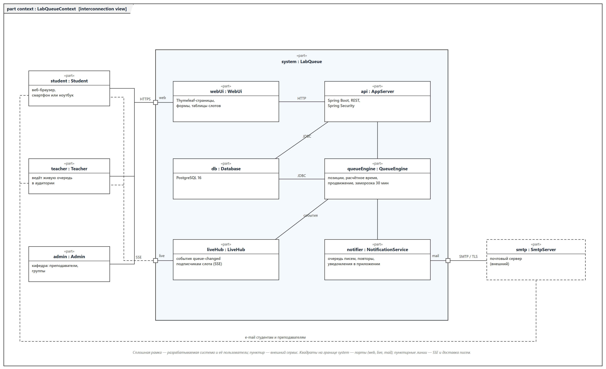
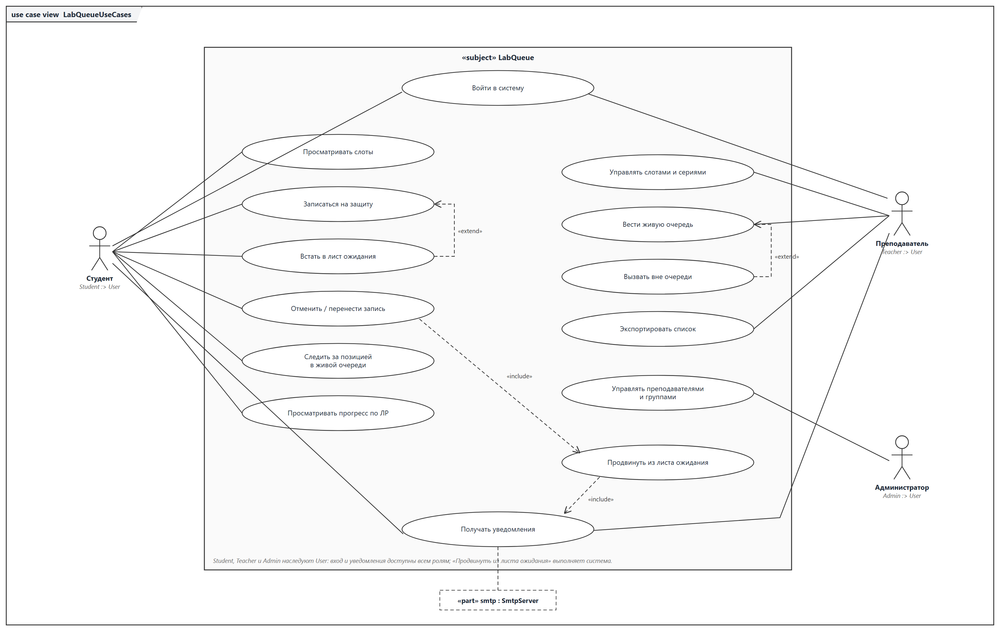
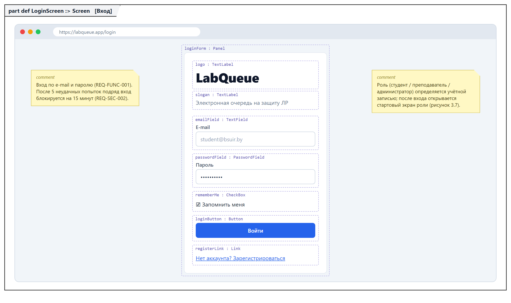
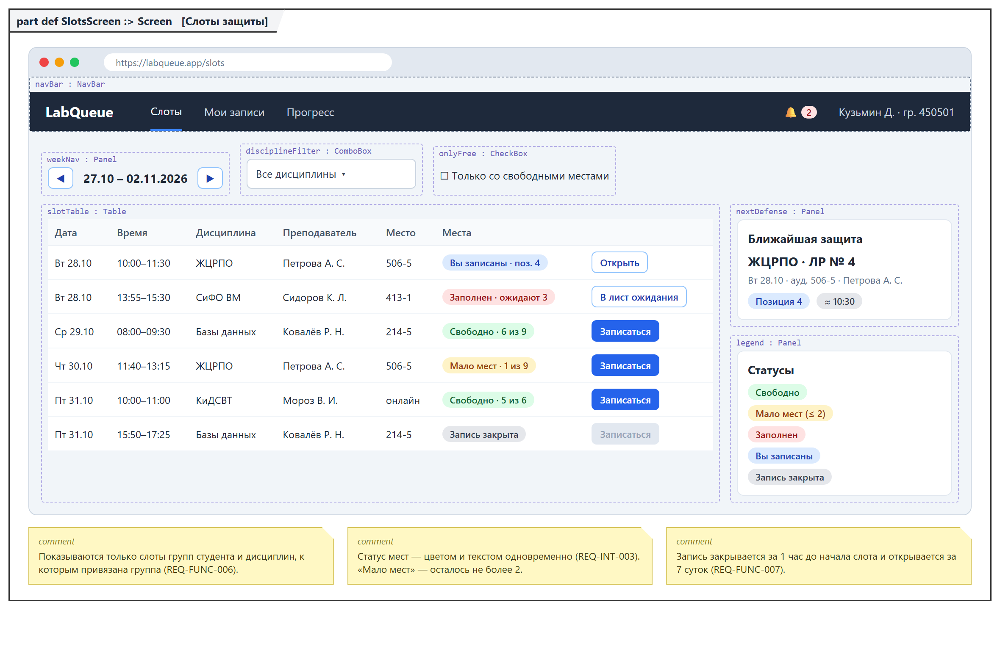
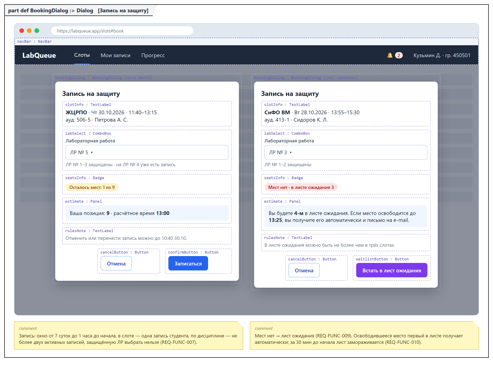
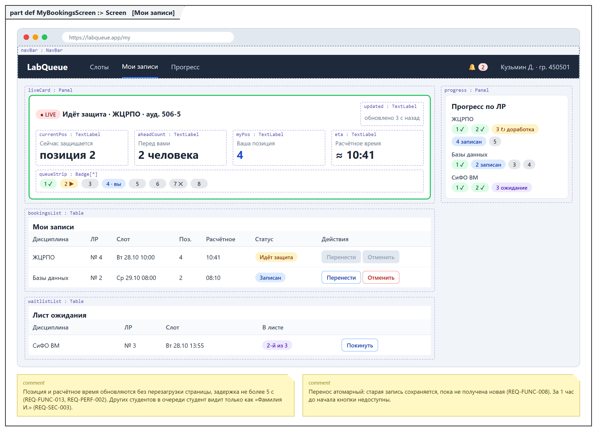
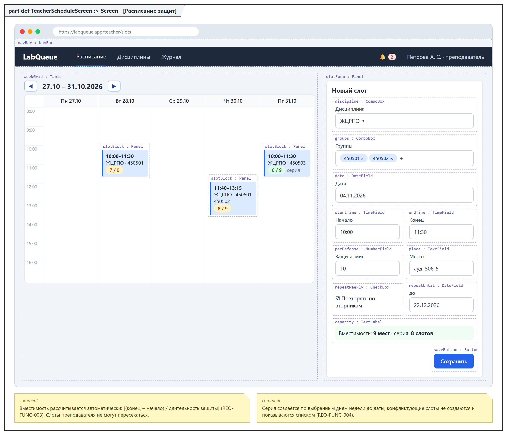
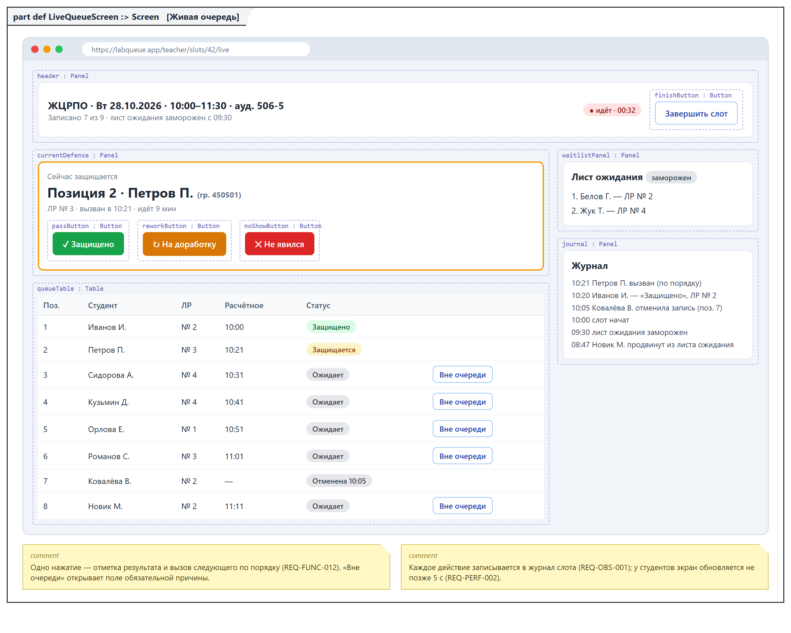
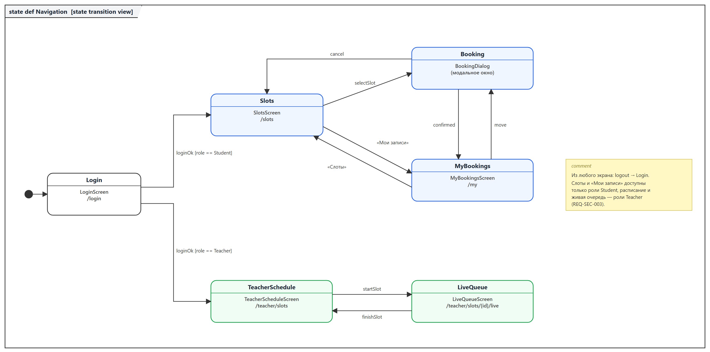
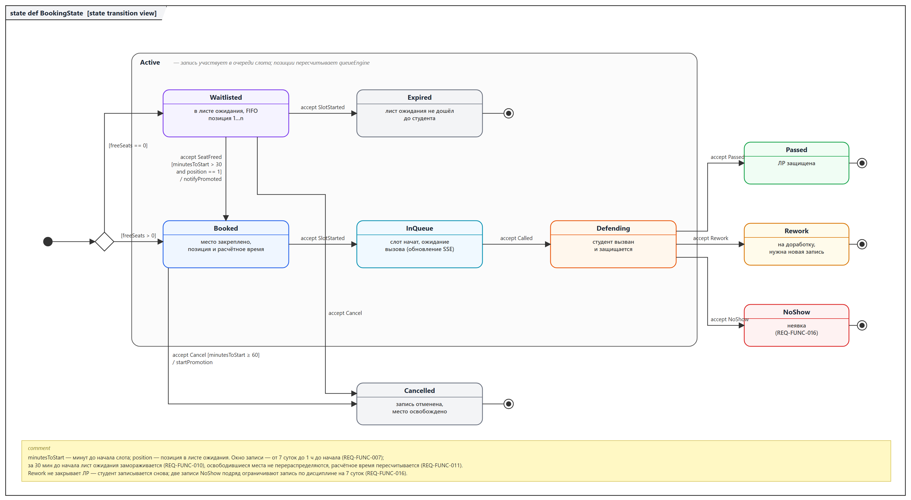

# Спецификация требований к ПО

Для LabQueue — веб-приложения «Электронная очередь на защиту лабораторных
работ»

Версия 0.2

Подготовил Рудольф Н. В., гр. 450501

БГУИР, факультет КСиС, кафедра ЭВМ

27.10.2026

## Оглавление

<!-- TOC -->
* [1. Введение](#1-introduction)
  * [1.1 Назначение документа](#11-document-purpose)
  * [1.2 Область применения продукта](#12-product-scope)
  * [1.3 Определения, акронимы и сокращения](#13-definitions-acronyms-and-abbreviations)
  * [1.4 Ссылки](#14-references)
  * [1.5 Обзор документа](#15-document-overview)
* [2. Обзор продукта](#2-product-overview)
  * [2.1 Перспектива продукта](#21-product-perspective)
  * [2.2 Функции продукта](#22-product-functions)
  * [2.3 Ограничения продукта](#23-product-constraints)
  * [2.4 Характеристики пользователей](#24-user-characteristics)
  * [2.5 Допущения и зависимости](#25-assumptions-and-dependencies)
  * [2.6 Распределение требований](#26-apportioning-of-requirements)
* [3. Требования](#3-requirements)
  * [3.1 Внешние интерфейсы](#31-external-interfaces)
    * [3.1.1 Пользовательские интерфейсы](#311-user-interfaces)
    * [3.1.2 Аппаратные интерфейсы](#312-hardware-interfaces)
    * [3.1.3 Программные интерфейсы](#313-software-interfaces)
  * [3.2 Функциональные требования](#32-functional)
  * [3.3 Качество обслуживания](#33-quality-of-service)
    * [3.3.1 Производительность](#331-performance)
    * [3.3.2 Безопасность](#332-security)
    * [3.3.3 Надёжность](#333-reliability)
    * [3.3.4 Доступность](#334-availability)
    * [3.3.5 Наблюдаемость](#335-observability)
  * [3.4 Соответствие стандартам](#34-compliance)
  * [3.5 Проектирование и реализация](#35-design-and-implementation)
    * [3.5.1 Установка](#351-installation)
    * [3.5.2 Сборка и поставка](#352-build-and-delivery)
    * [3.5.3 Распределение](#353-distribution)
    * [3.5.4 Сопровождаемость](#354-maintainability)
    * [3.5.5 Повторное использование](#355-reusability)
    * [3.5.6 Переносимость](#356-portability)
    * [3.5.7 Стоимость](#357-cost)
    * [3.5.8 Сроки](#358-deadline)
    * [3.5.9 Доказательство концепции](#359-proof-of-concept)
    * [3.5.10 Управление изменениями](#3510-change-management)
  * [3.6 ИИ/МО](#36-aiml)
* [4. Верификация](#4-verification)
* [5. Приложения](#5-appendixes)
<!-- TOC -->

## История изменений

| Name | Date | Reason For Changes | Version |
|------|------|--------------------|---------|
| Рудольф Н. В. | 20.10.2026 | Первая редакция по итогам интервью с Заказчиком (напарником по ЛР3) | 0.1 |
| Рудольф Н. В. | 27.10.2026 | Корректировки по замечаниям напарника и преподавателя (приложение В): в REQ-FUNC-008 добавлен перенос записи, в REQ-FUNC-012 — вызов вне очереди, в REQ-FUNC-010 — заморозка листа ожидания, добавлено REQ-SEC-003 | 0.2 |

---

## 1. Введение {#1-introduction}

Документ описывает бизнес-требования и требования к ПО для веб-приложения
LabQueue: что система должна делать, для кого и с какими ограничениями.
Требования собраны в ролевой игре «Заказчик — Менеджер проекта» в рамках
лабораторной работы № 3 по дисциплине ЖЦРПО; проект будет развиваться на
протяжении всего курса.

### 1.1 Назначение документа {#11-document-purpose}

SRS фиксирует согласованное с Заказчиком понимание продукта и служит основой
для проектирования (SDD), разработки и тестирования. Документ используют:
Заказчик — для согласования и приёмки; разработчики — для проектирования и
реализации; тестировщик — для построения тестов по разделу 4. SRS
определяет, **ЧТО** должна делать система, а не КАК она это делает;
архитектурные решения будут оформлены отдельно в `sdd/` и `adr/`.

### 1.2 Область применения продукта {#12-product-scope}

**LabQueue 1.0** — веб-приложение, которое заменяет «живую» очередь под
дверью аудитории и бумажные списки в чатах групп. Преподаватель публикует
окна защиты (слоты) с ограниченным числом мест, студенты заранее
записываются на защиту конкретной лабораторной работы, а если мест нет —
встают в лист ожидания. Главная особенность — **лист ожидания с
автоматическим продвижением и живая очередь с расчётным временем**:
освободившееся место сразу получает первый в листе ожидания, а во время
занятия каждый студент видит свою позицию и время, когда его вызовут.

**Бизнес-цели:**

| ID | Цель | Измеримый показатель |
|----|------|----------------------|
| BG-1 | Сократить ожидание у аудитории | среднее отклонение фактического начала защиты от расчётного времени ≤ 15 мин (сейчас студенты ждут 40–60 мин по опросу Заказчика) |
| BG-2 | Не терять места на защите | ≥ 90 % мест, освободившихся более чем за 30 мин до начала слота, занимаются из листа ожидания |
| BG-3 | Снизить ручную работу преподавателя | расписание защит на неделю публикуется не более чем за 5 минут, без списков в мессенджерах |
| BG-4 | Сделать порядок честным и прозрачным | порядок защиты определяется временем записи; каждое изменение очереди имеет автора, время и причину в журнале |

**Входит в рамки:** слоты защиты и их серии, запись и отмена записи, перенос
записи, лист ожидания, живая очередь, отметки о результатах защиты,
уведомления по e-mail и в приложении, журнал действий, экспорт списка
записанных.

**Не входит в рамки:** выставление оценок и интеграция с ИИС «БГУИР:
Университет», хранение файлов отчётов, онлайн-видеосвязь, нативные мобильные
приложения, Telegram- и SMS-уведомления.

Границы системы показаны на контекстной диаграмме (рисунок 1, раздел 2.1).

### 1.3 Определения, акронимы и сокращения {#13-definitions-acronyms-and-abbreviations}

| Term | Definition |
|------|------------|
| API | Application Programming Interface — набор определений и протоколов для интеграции программ |
| BCrypt | адаптивная функция хеширования паролей |
| Слот (окно защиты) | интервал времени преподавателя для защит по одной дисциплине: дата, начало, окончание, место, длительность одной защиты, группы |
| Вместимость слота | число мест = ⌊(окончание − начало) / длительность одной защиты⌋ |
| Запись | бронирование одного места в слоте студентом для защиты одной ЛР |
| Лист ожидания | упорядоченный по времени постановки (FIFO) список студентов, ожидающих места в заполненном слоте |
| Продвижение | автоматический перевод первого студента из листа ожидания в записанные при освобождении места |
| Заморозка | момент за 30 мин до начала слота, после которого лист ожидания не продвигается |
| Живая очередь | состояние слота во время занятия: текущий студент, порядок остальных и расчётное время |
| Расчётное время | начало слота + (позиция − 1) × длительность одной защиты с поправкой на фактический ход очереди |
| Неявка | отметка преподавателя «Не явился» для студента, вызванного в живой очереди |
| SSE | Server-Sent Events — односторонняя передача событий от сервера браузеру по HTTP |
| SRS | Software Requirements Specification — спецификация требований к ПО |
| SysML v2 | Systems Modeling Language v2 — язык моделирования систем, использован для диаграмм и макетов |
| UI | User Interface — пользовательский интерфейс |

### 1.4 Ссылки {#14-references}

| Документ | Версия / дата | Расположение | Статус |
|----------|---------------|--------------|--------|
| Шаблон SRS курса ЖЦРПО | 2026 | `srs/srs-template.md` | нормативная |
| ISO/IEC/IEEE 29148:2018 Requirements engineering | 2018 | iso.org | справочная |
| OMG SysML v2.0 | 2025 | omg.org/spec/SysML | справочная |
| HTML Living Standard, Server-sent events | актуальная | html.spec.whatwg.org | справочная |
| WCAG 2.1 | 2018 | w3.org/TR/WCAG21 | справочная |
| Закон РБ № 99-З «О защите персональных данных» | 07.05.2021 | pravo.by | нормативная |
| Модели SysML v2 | 0.2 | `srs/models/*.sysml` | справочная (приложение к SRS) |

### 1.5 Обзор документа {#15-document-overview}

Раздел 2 описывает контекст, функции, ограничения и пользователей продукта.
Раздел 3 содержит проверяемые требования с идентификаторами вида
`REQ-[AREA]-[NNN]`. Раздел 4 — матрица верификации, раздел 5 — перечень
диаграмм и макетов, протокол интервью, замечания ревью, открытые вопросы и
исключённые требования. Ключевые слова: «должна» — обязательное требование,
«следует» — желательное, «может» — необязательное. Документ ведётся в Git
(ветка `lab3`); каждое изменение вносится через pull request и отражается в
таблице «История изменений».

---

## 2. Обзор продукта {#2-product-overview}

### 2.1 Перспектива продукта {#21-product-perspective}

LabQueue — новый самостоятельный продукт; он не заменяет существующую
информационную систему. Сейчас очередь на защиту формируется в чатах групп
(«кто первый написал») или устно у двери аудитории, а преподаватель не знает
заранее, сколько студентов придёт. Существующие инструменты (Google Таблицы,
опросы в мессенджерах) не ограничивают число мест, не ведут лист ожидания и
не показывают ожидаемое время защиты.

Система взаимодействует с пользователями через веб-браузер и с одним внешним
сервисом — почтовым сервером (SMTP). Владелец продукта — Заказчик;
разработка и сопровождение — авторы документа. SLA на учебный период не
заключается; целевые показатели приведены в 3.3.

*Рисунок 1 — Контекст системы. Модель:
[`models/context.sysml`](models/context.sysml)*

### 2.2 Функции продукта {#22-product-functions}

**Расписание защит (преподаватель)**
- создание слотов защиты и еженедельных серий слотов для своих дисциплин и
  групп;
- изменение и отмена слота с уведомлением всех записанных;
- просмотр списка записанных и экспорт его в .csv.

**Запись (студент)**
- просмотр доступных слотов своих групп с числом свободных мест;
- запись на защиту конкретной ЛР, отмена и перенос записи;
- постановка в лист ожидания и автоматическое продвижение при освобождении
  места.

**Живая очередь**
- расчёт позиции и времени защиты каждого записанного студента;
- ведение очереди преподавателем: вызов, отметки «Защищено», «На доработку»,
  «Не явился»;
- отображение позиции и расчётного времени студенту в реальном времени;
- уведомления по e-mail и в приложении; журнал всех изменений очереди.

*Рисунок 2 — Варианты использования. Модель:
[`models/use-cases.sysml`](models/use-cases.sysml)*

### 2.3 Ограничения продукта {#23-product-constraints}

| ID | Ограничение | Тип |
|----|-------------|-----|
| CON-1 | Серверная часть должна быть написана на Java 21 с использованием Spring Boot 3.x | внутреннее, обязательное (требование Заказчика) |
| CON-2 | Клиентская часть должна работать в веб-браузере без установки дополнительного ПО; страницы формируются на сервере (Thymeleaf), обновление очереди — через SSE | внутреннее, обязательное |
| CON-3 | Для хранения данных должна использоваться СУБД PostgreSQL 16 | внутреннее, предпочтительное |
| CON-4 | Уведомления отправляются только по e-mail (SMTP) и внутри приложения; платные сервисы не используются | внешнее, обязательное (бюджет 0) |
| CON-5 | Обработка персональных данных должна соответствовать Закону РБ № 99-З | внешнее, обязательное |
| CON-6 | Интерфейс должен быть на русском языке | внутреннее, обязательное |
| CON-7 | Исходный код и документация хранятся в репозитории GitHub курса, изменения — через pull request | организационное, обязательное |

### 2.4 Характеристики пользователей {#24-user-characteristics}

| Класс | Описание | Частота использования | Подготовка | Права |
|-------|----------|-----------------------|------------|-------|
| Студент (Student) | основной пользователь, 17–23 года; сдаёт 3–6 дисциплин с ЛР в семестр; заходит со смартфона и ноутбука | 2–5 раз в неделю, чаще в дни защит | уверенный пользователь веб-сервисов | слоты своих групп, свои записи, позиции в очереди |
| Преподаватель (Teacher) | ведёт 1–4 дисциплины, 2–8 групп; принимает защиты в аудитории или онлайн | 1–3 раза в неделю, во время занятий — непрерывно | базовая | свои дисциплины и слоты, ведение живой очереди, журнал |
| Администратор (Admin) | сотрудник кафедры или разработчик | по необходимости | высокая | учётные записи преподавателей, группы, справочник дисциплин |

Студент в живой очереди видит других студентов только в виде фамилии и
инициалов (REQ-SEC-003). Интерфейс живой очереди преподавателя используется
на ноутбуке в аудитории, поэтому основные действия должны выполняться одним
нажатием.

### 2.5 Допущения и зависимости {#25-assumptions-and-dependencies}

| ID | Допущение / зависимость | Влияние, если неверно | Мера |
|----|-------------------------|-----------------------|------|
| AS-1 | У студентов и преподавателей есть e-mail (домен `bsuir.by` или личный) | нет канала e-mail | регистрация по любому e-mail с подтверждением |
| AS-2 | Списки групп предоставляются кафедрой в .csv | группы заводятся вручную | ручное создание группы администратором |
| AS-3 | Преподаватель готов публиковать слоты в системе заранее (не позднее чем за 2 дня) | студенты не успеют записаться | серия слотов на семестр (REQ-FUNC-004) |
| AS-4 | Во время защиты у преподавателя есть ноутбук или смартфон с доступом в Интернет | живая очередь не ведётся | печать списка записанных (REQ-FUNC-017) |
| AS-5 | Серверное время синхронизировано по NTP, часовой пояс Europe/Minsk | неверное расчётное время | хранение времени в UTC |
| DEP-1 | Внешний SMTP-сервер (например, Gmail SMTP или Яндекс 360) | — | конфигурируется через переменные окружения |
| DEP-2 | Бесплатный хостинг с Docker (например, учебный VPS кафедры) | развёртывание откладывается | запуск локально через docker compose |

### 2.6 Распределение требований {#26-apportioning-of-requirements}

| Требование | Компонент | Релиз |
|------------|-----------|-------|
| REQ-FUNC-001…003, 005…008 | webUi, api, db | R1 — MVP |
| REQ-FUNC-009…011, 014 | queueEngine, notifier | R1 — MVP |
| REQ-FUNC-012, 013 | queueEngine, liveHub (SSE), webUi | R2 |
| REQ-FUNC-004, 015 | api, webUi | R2 |
| REQ-FUNC-016, 017 | api, queueEngine | R3 |
| REQ-PERF, REQ-SEC, REQ-REL | все компоненты | R1–R3 |
| Интеграция с ИИС «БГУИР: Университет» | — | отложено, вне рамок 1.0 |
| Исключённые требования (Won't) | — | приложение Г |

Сроки релизов приведены в 3.5.8.

---

## 3. Требования {#3-requirements}

Все требования имеют идентификатор `REQ-[AREA]-[NNN]`. Приоритет по MoSCoW:
**M** — must, **S** — should, **C** — could; приоритет указан в поле More
Information или в скобках после ID. Методы верификации: Test (T),
Demonstration (D), Inspection (I), Analysis (A).

### 3.1 Внешние интерфейсы {#31-external-interfaces}

#### 3.1.1 Пользовательские интерфейсы {#311-user-interfaces}

Макеты экранов выполнены на SysML v2: каждый экран — `part def … :> Screen`,
элементы интерфейса — части (`part`) с атрибутами. Подписи `имя : Тип` на
рисунках совпадают с моделью
[`models/ui-mockups.sysml`](models/ui-mockups.sysml); изображения
формируются скриптом [`models/render.py`](models/render.py).

*Рисунок 3 — LoginScreen (`/login`)*

*Рисунок 4 — SlotsScreen (`/slots`), главный экран студента*

*Рисунок 5 — BookingDialog, модальное окно записи и постановки в лист
ожидания*

*Рисунок 6 — MyBookingsScreen (`/my`), позиция в очереди и листе ожидания*

*Рисунок 7 — TeacherScheduleScreen (`/teacher/slots`), создание слотов*

*Рисунок 8 — LiveQueueScreen (`/teacher/slots/{id}/live`), ведение защиты*

*Рисунок 9 — Автомат навигации `state def Navigation`*

- **ID:** REQ-INT-001
- **Title:** Адаптивная вёрстка
- **Statement:** Интерфейс должен корректно отображаться при ширине окна от
  360 до 1920 px в браузерах Chrome и Edge версии 120 и новее, Firefox 120 и
  новее, Safari 17 и новее.
- **Rationale:** студенты следят за очередью со смартфона, стоя у аудитории.
- **Acceptance Criteria:** на ширине 360 px нет горизонтальной прокрутки;
  таблица слотов переключается в режим карточек.
- **Verification Method:** Demonstration
- **More Information:** приоритет M.

- **ID:** REQ-INT-002
- **Title:** Язык и форматы
- **Statement:** Интерфейс должен быть на русском языке; даты — в формате
  ДД.ММ.ГГГГ, время — ЧЧ:ММ (24 ч), часовой пояс — Europe/Minsk.
- **Rationale:** CON-6, AS-5.
- **Acceptance Criteria:** все надписи и сообщения об ошибках на русском;
  даты и время во всех экранах и письмах в одном формате.
- **Verification Method:** Inspection
- **More Information:** приоритет M.

- **ID:** REQ-INT-003
- **Title:** Статус не только цветом
- **Statement:** Статус записи и слота (свободно, мало мест, заполнен, лист
  ожидания, защищено, на доработку, не явился) должен обозначаться цветом и
  текстовой меткой одновременно; контраст текста — не ниже 4.5:1 (WCAG 2.1
  AA).
- **Rationale:** доступность для пользователей с нарушением цветовосприятия.
- **Acceptance Criteria:** на всех экранах рядом с цветовым маркером есть
  текст статуса; проверка контраста инструментом Lighthouse без ошибок.
- **Verification Method:** Inspection
- **More Information:** приоритет S.

- **ID:** REQ-INT-004
- **Title:** Понятные ошибки
- **Statement:** При ошибке ввода или нарушении правила записи система
  должна показывать причину рядом с полем или кнопкой, не теряя введённые
  данные.
- **Rationale:** студент должен понимать, почему запись невозможна
  (например, ЛР уже защищена).
- **Acceptance Criteria:** при попытке записаться на уже защищённую ЛР
  показывается сообщение «ЛР № N уже защищена», остальные поля формы
  сохраняют значения.
- **Verification Method:** Test
- **More Information:** приоритет S.

#### 3.1.2 Аппаратные интерфейсы {#312-hardware-interfaces}

Специальных аппаратных интерфейсов нет. Клиент — любое устройство с
современным браузером (ПК, ноутбук, смартфон). Сервер — виртуальная машина
или контейнер с не менее чем 1 vCPU и 1 ГБ ОЗУ.

#### 3.1.3 Программные интерфейсы {#313-software-interfaces}

| Система | Протокол / формат | Направление | Ошибки и таймауты |
|---------|-------------------|-------------|-------------------|
| SMTP-сервер | SMTP + STARTTLS, порт 587, логин/пароль из переменных окружения | исходящий | таймаут 10 с, повтор по REQ-REL-002 |
| Браузер (живая очередь) | HTTPS, Server-Sent Events, `text/event-stream`, JSON-события `queue-changed` | исходящий от сервера | при обрыве браузер переподключается через 3 с; при недоступности SSE — опрос раз в 10 с |
| PostgreSQL 16 | JDBC | внутренний | пул соединений, таймаут 5 с |
| Экспорт списка | CSV (UTF-8, разделитель `;`) | исходящий (файл) | — |

### 3.2 Функциональные требования {#32-functional}

Жизненный цикл записи на защиту задан автоматом состояний (рисунок 10).

*Рисунок 10 — `state def BookingState`. Модель:
[`models/booking.sysml`](models/booking.sysml)*

**Учётные записи и справочники**

- **ID:** REQ-FUNC-001
- **Title:** Регистрация и вход
- **Statement:** Система должна позволять студенту зарегистрироваться по
  e-mail и паролю (не менее 8 символов, буквы и цифры) с указанием ФИО и
  группы, подтвердить e-mail по ссылке и входить в систему. Учётная запись
  преподавателя создаётся администратором; преподаватель задаёт пароль по
  ссылке-приглашению.
- **Rationale:** запись на защиту требует идентификации студента и проверки
  его группы.
- **Acceptance Criteria:** 1) без подтверждения e-mail вход невозможен; 2)
  после входа студент попадает на экран слотов, преподаватель — на экран
  расписания; 3) неверный пароль — сообщение «Неверный e-mail или пароль»
  без уточнения, что именно неверно.
- **Verification Method:** Test
- **More Information:** рисунок 3; REQ-SEC-001, REQ-SEC-002. Приоритет M.

- **ID:** REQ-FUNC-002
- **Title:** Дисциплины и группы
- **Statement:** Система должна позволять преподавателю создать дисциплину
  (название, число лабораторных работ от 1 до 15) и привязать к ней одну или
  несколько групп. Администратор ведёт справочник групп и может загрузить
  список студентов группы из .csv.
- **Rationale:** запись возможна только на ЛР существующей дисциплины своей
  группы.
- **Acceptance Criteria:** 1) студент видит слоты только тех дисциплин, к
  которым привязана его группа; 2) номер ЛР в записи ограничен числом ЛР
  дисциплины.
- **Verification Method:** Test
- **More Information:** приоритет M.

**Слоты защиты (преподаватель)**

- **ID:** REQ-FUNC-003
- **Title:** Создание слота
- **Statement:** Система должна позволять преподавателю создать слот защиты
  с полями: дисциплина, группы (одна или несколько из привязанных), дата,
  время начала и окончания (не менее 15 мин и не более 4 ч), место
  (аудитория или ссылка на онлайн-встречу), длительность одной защиты (5–30
  мин, по умолчанию 10). Вместимость рассчитывается автоматически.
- **Rationale:** основная функция преподавателя (BG-3).
- **Acceptance Criteria:** 1) слот 10:00–11:30 с длительностью 10 мин
  получает вместимость 9; 2) слот в прошлом, пересекающийся с другим слотом
  того же преподавателя или с окончанием раньше начала отклоняется с
  сообщением у поля; 3) созданный слот виден студентам групп не позже 1 с
  после сохранения.
- **Verification Method:** Test
- **More Information:** рисунок 7. Приоритет M.

- **ID:** REQ-FUNC-004
- **Title:** Серия слотов
- **Statement:** Системе следует позволять создать серию слотов: одинаковые
  параметры повторяются еженедельно в выбранные дни недели до указанной даты
  (не далее конца семестра). Слоты серии, пересекающиеся с уже
  существующими, не создаются, и преподаватель видит их список.
- **Rationale:** защиты проходят на тех же парах каждую неделю (BG-3, AS-3).
- **Acceptance Criteria:** серия «каждый вторник 10:00–11:30 до 22.12.2026»,
  созданная 20.10.2026, содержит 10 слотов; один конфликтный слот показан в
  отчёте и не создан.
- **Verification Method:** Test
- **More Information:** рисунок 7. Приоритет S.

- **ID:** REQ-FUNC-005
- **Title:** Изменение и отмена слота
- **Statement:** Преподаватель должен иметь возможность изменить место
  слота, продлить его окончание или отменить слот с указанием причины.
  Сокращение слота ниже числа уже записанных студентов запрещено. При отмене
  все записи и лист ожидания слота отменяются, а затронутые студенты
  получают уведомление с причиной.
- **Rationale:** преподаватель может заболеть или поменять аудиторию.
- **Acceptance Criteria:** 1) после отмены слота каждый записанный и
  ожидающий студент получает письмо и уведомление в приложении не позже 5
  мин; 2) попытка сократить слот с 8 записанными до вместимости 6
  отклоняется с сообщением.
- **Verification Method:** Test
- **More Information:** приоритет M.

**Запись (студент)**

- **ID:** REQ-FUNC-006
- **Title:** Просмотр слотов
- **Statement:** Система должна показывать студенту слоты его групп на
  выбранную неделю с фильтром по дисциплине: дата, время, место,
  преподаватель, число свободных мест или длина листа ожидания, а также
  статус его собственной записи в каждом слоте.
- **Rationale:** студент выбирает удобное время защиты.
- **Acceptance Criteria:** 1) слоты чужих групп не отображаются; 2) число
  свободных мест совпадает с вместимостью минус число активных записей; 3)
  статусы «Свободно», «Мало мест» (≤ 2), «Заполнен» отображаются цветом и
  текстом.
- **Verification Method:** Test
- **More Information:** рисунок 4; REQ-INT-003. Приоритет M.

- **ID:** REQ-FUNC-007
- **Title:** Запись на защиту
- **Statement:** Система должна позволять студенту записаться в слот на
  защиту одной ЛР выбранной дисциплины. Правила: запись открывается за 7
  суток и закрывается за 1 час до начала слота; в одном слоте у студента не
  более одной записи; по одной дисциплине не более двух активных записей; на
  уже защищённую ЛР записаться нельзя. Студент получает номер в очереди и
  расчётное время.
- **Rationale:** изюминка продукта — заранее известное время защиты вместо
  очереди у двери (BG-1).
- **Acceptance Criteria:** 1) при наличии мест запись создаётся, в «Моих
  записях» отображаются позиция и расчётное время; 2) нарушение любого
  правила отклоняется с сообщением о причине; 3) за 59 минут до начала
  кнопка «Записаться» недоступна.
- **Verification Method:** Test
- **More Information:** рисунки 4, 5; REQ-REL-001. Приоритет M.

- **ID:** REQ-FUNC-008
- **Title:** Отмена и перенос записи
- **Statement:** Студент должен иметь возможность отменить запись не позднее
  чем за 1 час до начала слота и перенести запись в другой слот той же
  дисциплины. Перенос выполняется атомарно: новая запись создаётся до
  освобождения старого места; если в новом слоте мест нет, студент ставится
  в его лист ожидания с сохранением текущей записи.
- **Rationale:** студент не должен терять место при смене времени (замечание
  № 1, приложение В).
- **Acceptance Criteria:** 1) после отмены место освобождается и запускается
  продвижение (REQ-FUNC-010); 2) при неуспешном переносе исходная запись
  остаётся без изменений; 3) за 59 минут до начала отмена недоступна,
  показывается подсказка «Сообщите преподавателю».
- **Verification Method:** Test
- **More Information:** рисунок 6. Приоритет M.

**Лист ожидания**

- **ID:** REQ-FUNC-009
- **Title:** Постановка в лист ожидания
- **Statement:** Если в слоте нет свободных мест, система должна предлагать
  студенту встать в лист ожидания этого слота с теми же правилами, что и при
  записи. Студент видит свою позицию в листе ожидания и может покинуть его в
  любой момент. Студент может одновременно находиться не более чем в трёх
  листах ожидания.
- **Rationale:** часть мест освобождается из-за отмен; без листа ожидания
  они пропадают (BG-2).
- **Acceptance Criteria:** 1) в заполненном слоте вместо кнопки «Записаться»
  отображается кнопка «В лист ожидания» и текущая длина листа; 2) позиции
  присваиваются в порядке постановки.
- **Verification Method:** Test
- **More Information:** рисунки 5, 6. Приоритет M.

- **ID:** REQ-FUNC-010
- **Title:** Автоматическое продвижение
- **Statement:** При освобождении места (отмена, перенос, продление слота)
  система должна в течение 1 минуты перевести первого студента из листа
  ожидания в записанные и уведомить его по e-mail и в приложении. За 30
  минут до начала слота лист ожидания замораживается: освободившиеся места
  не перераспределяются, а расчётное время остальных студентов
  пересчитывается.
- **Rationale:** изюминка продукта (BG-2); заморозка исключает вызов
  студента, который не успеет прийти (замечание № 5, приложение В).
- **Acceptance Criteria:** 1) после отмены записи за 2 ч до начала первый
  ожидающий получает место и письмо «Вы записаны»; 2) после отмены за 20 мин
  до начала лист ожидания не меняется, а расчётное время студентов после
  освободившейся позиции уменьшается на длительность одной защиты; 3)
  продвижение записывается в журнал.
- **Verification Method:** Test
- **More Information:** рисунок 10. Приоритет M.

**Живая очередь**

- **ID:** REQ-FUNC-011
- **Title:** Порядок и расчётное время
- **Statement:** Порядок защиты в слоте должен определяться временем записи
  (FIFO; студент, продвинутый из листа ожидания, встаёт в конец). Расчётное
  время студента = начало слота + (позиция − 1) × длительность одной защиты;
  во время занятия оно пересчитывается от момента вызова текущего студента.
- **Rationale:** честный и предсказуемый порядок (BG-1, BG-4).
- **Acceptance Criteria:** 1) для слота 10:00, длительность 10 мин, студент
  на позиции 4 видит 10:30; 2) если защита студента на позиции 1 закончилась
  в 10:15, расчётное время позиции 4 становится 10:35.
- **Verification Method:** Test
- **More Information:** рисунки 6, 8. Приоритет M.

- **ID:** REQ-FUNC-012
- **Title:** Ведение живой очереди
- **Statement:** Преподаватель должен иметь возможность начать слот и
  вызывать студентов по порядку, отмечая результат текущей защиты:
  «Защищено», «На доработку» или «Не явился». Действие «Вызвать вне очереди»
  доступно с обязательным указанием причины. Отметки можно исправить до
  окончания слота.
- **Rationale:** преподаватель ведёт очередь одним нажатием, не отвлекаясь
  от защиты (BG-3).
- **Acceptance Criteria:** 1) после нажатия «Защищено» текущим становится
  следующий студент; 2) вызов вне очереди без причины невозможен; причина
  видна в журнале; 3) ЛР с отметкой «Защищено» отображается у студента как
  защищённая.
- **Verification Method:** Test
- **More Information:** рисунок 8; замечание № 4 (приложение В). Приоритет
  M.

- **ID:** REQ-FUNC-013
- **Title:** Позиция студента в реальном времени
- **Statement:** Во время слота система должна показывать студенту: кто
  сейчас защищается (номер позиции), сколько человек перед ним и его
  расчётное время. При изменении очереди экран обновляется без перезагрузки
  страницы.
- **Rationale:** студент приходит к аудитории к своему времени (BG-1).
- **Acceptance Criteria:** после отметки преподавателя данные на экране
  студента обновляются в пределах времени, указанного в REQ-PERF-002, без
  действий пользователя.
- **Verification Method:** Demonstration
- **More Information:** рисунок 6; REQ-PERF-002. Приоритет M.

**Уведомления и история**

- **ID:** REQ-FUNC-014
- **Title:** Уведомления
- **Statement:** Системе следует отправлять уведомления по e-mail и в
  приложении о событиях: запись создана или отменена; студент продвинут из
  листа ожидания; слот изменён или отменён; напоминание за 1 час до
  расчётного времени; «вы следующий» в живой очереди (только в приложении).
  Студент может отключить письма-напоминания, но не письма об отмене и
  продвижении.
- **Rationale:** студент не должен постоянно проверять сайт (BG-1, BG-2).
- **Acceptance Criteria:** письмо о продвижении приходит не позже 5 мин
  после события; в настройках нельзя отключить уведомления об отмене слота.
- **Verification Method:** Test
- **More Information:** REQ-REL-002. Приоритет S.

- **ID:** REQ-FUNC-015
- **Title:** Прогресс по дисциплине
- **Statement:** Системе следует показывать студенту по каждой дисциплине
  список ЛР со статусом последней защиты (не защищалась, записан, на
  доработку, защищено), а преподавателю — сводную таблицу «студенты × ЛР» по
  группе.
- **Rationale:** студент и преподаватель видят, какие ЛР осталось защитить.
- **Acceptance Criteria:** после отметки «Защищено» статус ЛР в сводке
  обновляется; ЛР со статусом «Защищено» недоступна для новой записи.
- **Verification Method:** Test
- **More Information:** рисунок 6. Приоритет S.

- **ID:** REQ-FUNC-016
- **Title:** Ограничение после неявок
- **Statement:** Система может ограничивать запись студента по дисциплине на
  7 суток после двух неявок подряд по этой дисциплине. Преподаватель может
  снять ограничение досрочно.
- **Rationale:** неявки занимают места, которые могли бы получить другие
  (BG-2).
- **Acceptance Criteria:** после второй неявки подряд кнопка «Записаться» по
  дисциплине недоступна с подсказкой о дате снятия ограничения; лист
  ожидания также недоступен.
- **Verification Method:** Test
- **More Information:** приоритет C.

- **ID:** REQ-FUNC-017
- **Title:** Экспорт списка записанных
- **Statement:** Система может формировать для преподавателя файл .csv и
  версию для печати со списком записанных в слот: позиция, ФИО, группа,
  номер ЛР, расчётное время.
- **Rationale:** запасной вариант при отсутствии Интернета в аудитории
  (AS-4).
- **Acceptance Criteria:** CSV открывается в Excel без искажения кириллицы,
  порядок строк совпадает с очередью.
- **Verification Method:** Demonstration
- **More Information:** приоритет C.

### 3.3 Качество обслуживания {#33-quality-of-service}

#### 3.3.1 Производительность {#331-performance}

- **ID:** REQ-PERF-001
- **Title:** Время отклика
- **Statement:** 95 % запросов страниц и операций записи должны
  обрабатываться не дольше 1 с при 200 одновременно работающих
  пользователях.
- **Rationale:** запись на популярные слоты открывается одновременно для
  всего потока.
- **Acceptance Criteria:** нагрузочный тест (200 виртуальных пользователей,
  10 мин) — p95 ≤ 1 с, доля ошибок ≤ 1 %.
- **Verification Method:** Test
- **More Information:** приоритет S.

- **ID:** REQ-PERF-002
- **Title:** Скорость обновления очереди
- **Statement:** Изменение живой очереди должно отображаться у всех
  подключённых клиентов слота не позже 5 с после действия преподавателя.
- **Rationale:** устаревшая позиция приводит к опозданиям (BG-1).
- **Acceptance Criteria:** при 60 подключённых клиентах задержка от отметки
  до обновления экрана — не более 5 с у 100 % клиентов.
- **Verification Method:** Test
- **More Information:** приоритет M.

#### 3.3.2 Безопасность {#332-security}

- **ID:** REQ-SEC-001
- **Title:** Защита учётных данных
- **Statement:** Пароли должны храниться только в виде хеша BCrypt (cost ≥
  10); весь трафик — по HTTPS (TLS 1.2+); сессионная cookie — с флагами
  HttpOnly, Secure, SameSite=Lax.
- **Rationale:** защита учётных данных пользователей.
- **Acceptance Criteria:** в БД нет паролей в открытом виде; запрос по HTTP
  перенаправляется на HTTPS.
- **Verification Method:** Inspection
- **More Information:** приоритет M.

- **ID:** REQ-SEC-002
- **Title:** Ограничение попыток входа
- **Statement:** После 5 неудачных попыток входа подряд вход для учётной
  записи блокируется на 15 минут.
- **Rationale:** защита от подбора пароля.
- **Acceptance Criteria:** шестая попытка в течение 15 мин отклоняется даже
  с верным паролем.
- **Verification Method:** Test
- **More Information:** приоритет S.

- **ID:** REQ-SEC-003
- **Title:** Разграничение доступа и приватность
- **Statement:** Каждое действие должно проверяться на сервере по роли и
  принадлежности: студент записывается только в слоты своих групп и
  управляет только своими записями; преподаватель управляет только своими
  слотами. В очереди студент видит других студентов только как «Фамилия И.»
  без e-mail и группы.
- **Rationale:** персональные данные (CON-5); замечание № 6 (приложение В).
- **Acceptance Criteria:** запрос на запись в слот чужой группы или отмену
  чужой записи через API возвращает HTTP 403; в ответе API очереди для
  студента нет e-mail других студентов.
- **Verification Method:** Test
- **More Information:** приоритет M.

- **ID:** REQ-SEC-004
- **Title:** Защита от CSRF и инъекций
- **Statement:** Все изменяющие запросы должны быть защищены CSRF-токеном;
  запросы к БД — только параметризованные.
- **Rationale:** типовые уязвимости веб-приложений (OWASP Top 10).
- **Acceptance Criteria:** POST-запрос без CSRF-токена отклоняется (HTTP
  403); статический анализ не находит SQL-конкатенации.
- **Verification Method:** Test / Inspection
- **More Information:** приоритет M.

#### 3.3.3 Надёжность {#333-reliability}

- **ID:** REQ-REL-001
- **Title:** Конкурентная запись
- **Statement:** При одновременных запросах на запись в слот число активных
  записей никогда не должно превышать вместимость слота, а позиции в очереди
  и листе ожидания — повторяться.
- **Rationale:** запись на последнее место — самый частый конфликт
  (REQ-FUNC-007).
- **Acceptance Criteria:** 50 параллельных запросов на запись в слот с одним
  свободным местом дают ровно 1 запись; остальные студенты получают
  предложение встать в лист ожидания.
- **Verification Method:** Test
- **More Information:** приоритет M.

- **ID:** REQ-REL-002
- **Title:** Повтор отправки писем
- **Statement:** При ошибке SMTP письмо должно повторно отправляться до 3
  раз с интервалом 1, 5 и 15 минут; ошибка отправки не должна отменять
  запись или продвижение.
- **Rationale:** почтовый сервер может быть временно недоступен.
- **Acceptance Criteria:** при отключённом SMTP запись создаётся; после
  восстановления SMTP письмо доставляется; после 3 неудач событие
  записывается в журнал ошибок.
- **Verification Method:** Test
- **More Information:** приоритет S.

#### 3.3.4 Доступность {#334-availability}

- **ID:** REQ-AVAIL-001
- **Title:** Доступность в учебное время
- **Statement:** Системе следует быть доступной не менее 99 % времени с
  08:00 до 21:00 по будням учебного семестра; плановые работы — только вне
  этого интервала.
- **Rationale:** защиты проходят во время пар.
- **Acceptance Criteria:** по данным мониторинга за месяц доступность в
  учебное время ≥ 99 %.
- **Verification Method:** Analysis
- **More Information:** приоритет S.

- **ID:** REQ-AVAIL-002
- **Title:** Резервное копирование
- **Statement:** Резервную копию БД следует создавать ежедневно и хранить 14
  дней; восстановление из копии должно занимать не более 1 часа.
- **Rationale:** потеря очередей и отметок защит недопустима.
- **Acceptance Criteria:** восстановление на чистой машине из копии
  выполнено за ≤ 1 ч по инструкции из README.
- **Verification Method:** Demonstration
- **More Information:** приоритет S.

#### 3.3.5 Наблюдаемость {#335-observability}

- **ID:** REQ-OBS-001
- **Title:** Журнал очереди
- **Statement:** Каждое изменение записи и очереди (создание, отмена,
  перенос, продвижение, вызов, отметка, вызов вне очереди) должно
  записываться в журнал: время, автор, слот, студент, действие, причина.
  Журнал слота доступен преподавателю.
- **Rationale:** прозрачность порядка и разбор спорных ситуаций (BG-4).
- **Acceptance Criteria:** для любого студента слота по журналу
  восстанавливается история его позиции; записи журнала нельзя изменить или
  удалить через интерфейс.
- **Verification Method:** Inspection
- **More Information:** приоритет S.

- **ID:** REQ-OBS-002
- **Title:** Мониторинг
- **Statement:** Приложение может публиковать состояние и метрики через
  `/actuator/health` и `/actuator/prometheus`: число активных
  SSE-подключений, время обработки запросов, очередь неотправленных писем.
- **Rationale:** контроль REQ-PERF и REQ-AVAIL.
- **Acceptance Criteria:** эндпоинты отвечают HTTP 200, метрики содержат
  перечисленные значения.
- **Verification Method:** Demonstration
- **More Information:** приоритет C.

### 3.4 Соответствие стандартам {#34-compliance}

- **REQ-COMP-001** (M) — обработка персональных данных (ФИО, e-mail, группа,
  результаты защит) должна соответствовать Закону РБ № 99-З: согласие при
  регистрации, политика конфиденциальности, удаление учётной записи по
  запросу (CON-5, REQ-SEC-003).
- **REQ-COMP-002** (M) — используемые библиотеки должны иметь лицензии,
  допускающие бесплатное использование (Apache 2.0, MIT, BSD, LGPL);
  перечень лицензий хранится в репозитории.
- **REQ-COMP-003** (M) — документация оформляется по шаблонам курса (`srs/`,
  `sdd/`, `adr/`), отчёты — по СТП БГУИР.

### 3.5 Проектирование и реализация {#35-design-and-implementation}

#### 3.5.1 Установка {#351-installation}

- **REQ-INST-001** (M) — приложение должно запускаться одной командой
  `docker compose up` (контейнеры приложения и PostgreSQL); настройки (URL
  БД, SMTP, часовой пояс) задаются переменными окружения, пример — в
  `.env.example`.
- **REQ-INST-002** (M) — миграции схемы БД должны применяться автоматически
  при запуске (Flyway).

#### 3.5.2 Сборка и поставка {#352-build-and-delivery}

- **REQ-BUILD-001** (M) — сборка — Maven, JDK 21; результат — исполняемый
  JAR и Docker-образ.
- **REQ-BUILD-002** (S) — каждый pull request проверяется в GitHub Actions:
  сборка, модульные тесты, статический анализ (Checkstyle).

#### 3.5.3 Распределение {#353-distribution}

Один экземпляр приложения и одна БД; горизонтальное масштабирование в версии
1.0 не требуется. Целостность очереди обеспечивается транзакциями и
блокировкой строки слота в PostgreSQL (`SELECT … FOR UPDATE`), поэтому при
будущем масштабировании правила REQ-REL-001 сохраняются.

#### 3.5.4 Сопровождаемость {#354-maintainability}

- **REQ-MAINT-001** (S) — код разделяется на модули: `web`, `slot`,
  `booking`, `queue`, `notification`, `security`; правила очереди и листа
  ожидания реализуются в модуле `queue` без зависимостей от веб-слоя; README
  содержит инструкции по сборке, запуску и настройке.
- **REQ-MAINT-002** (S) — покрытие модульными тестами модуля `queue` — не
  менее 80 %, проекта в целом — не менее 60 %.

#### 3.5.5 Повторное использование {#355-reusability}

Модуль `queue` (расчёт позиций, расчётного времени и продвижения) следует
проектировать как независимую библиотеку на чистом Java без Spring, чтобы
использовать его для других видов очередей (консультации, пересдачи).

#### 3.5.6 Переносимость {#356-portability}

- **REQ-PORT-001** (M) — сервер работает в Docker на Linux x86_64 и ARM64;
  для разработки — запуск на Windows и macOS через Docker Desktop; время
  хранится в UTC и отображается в часовом поясе Europe/Minsk.

#### 3.5.7 Стоимость {#357-cost}

Бюджет на сервисы — 0 BYN: используются только бесплатный SMTP и бесплатный
хостинг или учебный сервер кафедры. Платные API (SMS, push-сервисы) не
применяются (CON-4).

#### 3.5.8 Сроки {#358-deadline}

| Этап | Содержание | Срок |
|------|------------|------|
| ЛР3 | SRS, макеты, согласование с Заказчиком | октябрь 2026 |
| ЛР4–5 | SDD, ADR, архитектура и модель данных | ноябрь 2026 |
| R1 — MVP | REQ-FUNC-001…003, 005…011, 014 | ноябрь 2026 |
| R2 | живая очередь (REQ-FUNC-012, 013), серии слотов, прогресс | декабрь 2026 |
| R3 | ограничения неявок, экспорт, тестирование, защита | до конца семестра |

#### 3.5.9 Доказательство концепции {#359-proof-of-concept}

**POC-1:** до начала R2 проверить обновление живой очереди через SSE на
бесплатном хостинге (прокси не должен буферизовать `text/event-stream`).
Критерий успеха — 60 клиентов получают 20 событий из 20 с задержкой ≤ 5 с.
При неудаче используется периодический опрос раз в 5 с.

#### 3.5.10 Управление изменениями {#3510-change-management}

Изменения требований вносятся только через pull request в ветку `main` с
указанием инициатора (Заказчик, преподаватель, разработчик) и затронутых ID.
Изменённое требование получает суффикс версии (`REQ-FUNC-007-2`), запись
добавляется в «Историю изменений». Требования, полученные от преподавателя
во время занятия, вносятся до конца этой пары. До первого слияния в `main`
(версия 1.0) идентификаторы не версионируются: правки по результатам ревью
фиксируются в «Истории изменений» и приложении В.

### 3.6 ИИ/МО {#36-aiml}

Не применимо: LabQueue 1.0 не использует моделей машинного обучения. Позиции
и расчётное время вычисляются детерминированно по правилам REQ-FUNC-010 и
REQ-FUNC-011.

---

## 4. Верификация {#4-verification}

Тесты будут храниться в `project/src/test/java`; приёмочные сценарии — в
`docs/tests/` (создаются на этапе разработки). Тестовое окружение — docker
compose с PostgreSQL и почтовой заглушкой MailHog; время в тестах
подменяется через `java.time.Clock`.

| Requirement ID | Verification Method | Test/Artifact Link | Status | Evidence |
|----------------|---------------------|--------------------|--------|----------|
| REQ-FUNC-001 | Test | tests/UC01-login.md | Planned | |
| REQ-FUNC-002 | Test | DisciplineGroupTest | Planned | |
| REQ-FUNC-003 | Test | SlotCapacityTest | Planned | |
| REQ-FUNC-004 | Test | SlotSeriesTest | Planned | |
| REQ-FUNC-005 | Test | SlotCancelTest | Planned | |
| REQ-FUNC-006 | Test | tests/UC02-view-slots.md | Planned | |
| REQ-FUNC-007 | Test | BookingRulesTest | Planned | |
| REQ-FUNC-008 | Test | BookingCancelMoveTest | Planned | |
| REQ-FUNC-009 | Test | WaitlistJoinTest | Planned | |
| REQ-FUNC-010 | Test | WaitlistPromotionTest (границы 31/30/29 мин) | Planned | |
| REQ-FUNC-011 | Test | EstimatedTimeTest | Planned | |
| REQ-FUNC-012 | Test | LiveQueueTest | Planned | |
| REQ-FUNC-013 | Demonstration | tests/UC05-live-position.md | Planned | |
| REQ-FUNC-014 | Test | NotificationTest | Planned | |
| REQ-FUNC-015 | Test | ProgressTest | Planned | |
| REQ-FUNC-016 | Test | NoShowRestrictionTest | Planned | |
| REQ-FUNC-017 | Demonstration | tests/UC07-export.md | Planned | |
| REQ-INT-001…004 | Demonstration / Inspection | чек-лист UI, Lighthouse | Planned | |
| REQ-PERF-001…002 | Test | нагрузочный сценарий Gatling | Planned | |
| REQ-SEC-001…004 | Test / Inspection | SecurityTest, OWASP ZAP | Planned | |
| REQ-REL-001 | Test | ConcurrentBookingTest | Planned | |
| REQ-REL-002 | Test | MailRetryTest | Planned | |
| REQ-AVAIL-001…002 | Analysis / Demonstration | мониторинг, восстановление из бэкапа | Planned | |
| REQ-OBS-001…002 | Inspection / Demonstration | журнал слота, /actuator/prometheus | Planned | |
| REQ-COMP-001…003 | Inspection | политика конфиденциальности, перечень лицензий, ревью документов | Planned | |
| REQ-INST-001…002 | Demonstration | запуск `docker compose up` на чистой машине | Planned | |
| REQ-BUILD-001…002 | Inspection | `pom.xml`, workflow GitHub Actions | Planned | |
| REQ-MAINT-001…002 | Inspection / Analysis | структура модулей, отчёт JaCoCo, README | Planned | |
| REQ-PORT-001 | Demonstration / Test | образы linux/amd64 и linux/arm64, TimeZoneTest | Planned | |

---

## 5. Приложения {#5-appendixes}

**Приложение А. Графическая часть (SysML v2)**

| Файл | Содержание | Исходная модель |
|------|------------|-----------------|
| [images/context.png](images/context.png) | контекст системы, порты и внешние сервисы | [models/context.sysml](models/context.sysml) |
| [images/use-cases.png](images/use-cases.png) | варианты использования | [models/use-cases.sysml](models/use-cases.sysml) |
| [images/booking-states.png](images/booking-states.png) | автомат состояний записи | [models/booking.sysml](models/booking.sysml) |
| [images/ui-login.png](images/ui-login.png) | макет экрана входа | [models/ui-mockups.sysml](models/ui-mockups.sysml) |
| [images/ui-slots.png](images/ui-slots.png) | макет экрана слотов студента | то же |
| [images/ui-booking-dialog.png](images/ui-booking-dialog.png) | макет окна записи | то же |
| [images/ui-my-bookings.png](images/ui-my-bookings.png) | макет экрана «Мои записи» | то же |
| [images/ui-teacher-schedule.png](images/ui-teacher-schedule.png) | макет расписания преподавателя | то же |
| [images/ui-live-queue.png](images/ui-live-queue.png) | макет живой очереди | то же |
| [images/ui-navigation.png](images/ui-navigation.png) | навигация между экранами | то же |

Перегенерация PNG: `python srs/models/render.py` (требуется установленный
Google Chrome или Microsoft Edge).

**Приложение Б. Протокол интервью с Заказчиком (сокращённо)**

| № | Вопрос Менеджера проекта | Ответ Заказчика |
|---|--------------------------|-----------------|
| 1 | Какую проблему решаем? | Студенты часами стоят у аудитории, очередь пишут в чате «кто первый», многие так и не успевают защититься. |
| 2 | Кто пользователи? | Студенты и преподаватели; администратор кафедры заводит преподавателей и группы. |
| 3 | Как сейчас преподаватель назначает защиты? | Говорит на паре или пишет старосте; сколько придёт людей — неизвестно. |
| 4 | Что такое «слот» и сколько в нём мест? | Пара или её часть; на одну защиту уходит около 10 минут, мест столько, сколько успевает принять преподаватель. |
| 5 | Что делать, если мест нет? | Записываться в лист ожидания; если кто-то отказался, место должен сразу получать следующий. |
| 6 | Можно ли менять порядок? | Нет, порядок по времени записи; исключение — преподаватель может вызвать кого-то раньше, но это должно быть видно. |
| 7 | Как студенту узнать, когда его вызовут? | Видеть на телефоне свою позицию и примерное время; получать письмо, если место освободилось. |
| 8 | Что делать с теми, кто записался и не пришёл? | Отмечать неявку; если это повторяется — временно не давать записываться. |
| 9 | На чём писать и где запускать? | Java, веб-приложение, бесплатный хостинг; без платных SMS. |
| 10 | Как понять, что проект успешен? | Никто не ждёт у двери больше 15 минут, а отменённые места не пропадают. |

**Приложение В. Замечания по результатам ревью**

Замечания получены при ревью версии 0.1 от напарника (Заказчика) и
преподавателя. Замечание принимается, если указывает на неоднозначное,
непроверяемое или противоречивое требование либо на пропущенный сценарий;
отклоняется, если выходит за рамки продукта или противоречит бизнес-целям и
ограничениям.

| № | Автор | Замечание | Решение | Обоснование / изменение |
|---|-------|-----------|---------|-------------------------|
| 1 | напарник | Чтобы сменить время, студент должен отменить запись и рискует остаться без места | принято | В REQ-FUNC-008 добавлен атомарный перенос записи |
| 2 | напарник | Разрешить защищать две ЛР за одну запись | отклонено | Делает расчётное время непредсказуемым (BG-1); студент может записаться в слот дважды по разным дисциплинам или выбрать слот с большей длительностью защиты |
| 3 | напарник | Добавить уведомления в Telegram | отклонено | Требует внешнего бота и не влияет на бизнес-цели; перенесено в Won't (приложение Г, W-2) |
| 4 | напарник | Преподаватель иногда вызывает студента раньше — например, если тот пришёл с другой пары | принято | В REQ-FUNC-012 добавлено действие «Вызвать вне очереди» с обязательной причиной и записью в журнал |
| 5 | преподаватель | Не определено, что происходит с листом ожидания, если место освободилось за 5 минут до начала | принято | В REQ-FUNC-010 введена заморозка листа ожидания за 30 мин и пересчёт расчётного времени |
| 6 | преподаватель | Не указано, какие данные других студентов видит студент в очереди | принято | Добавлено REQ-SEC-003; права ролей уточнены в 2.4 |

**Приложение Г. Исключённые требования (Won't) и открытые вопросы**

| ID | Содержание | Решение |
|----|------------|---------|
| W-1 | Выставление оценок и передача результатов в ИИС «БГУИР: Университет» | Won't в 1.0 (раздел 1.2) |
| W-2 | Уведомления в Telegram и SMS | Won't: внешний сервис / платный канал (CON-4) |
| W-3 | Нативные мобильные приложения | Won't в 1.0; адаптивная вёрстка закрывает сценарий (REQ-INT-001) |
| W-4 | Загрузка файлов отчётов к записи | Won't в 1.0; отчёты сдаются по правилам преподавателя |
| OQ-1 | Хостинг: учебный VPS кафедры или бесплатный облачный тариф | решить до начала R1 (DEP-2) |
| OQ-2 | Интервал заморозки 30 мин в REQ-FUNC-010 | уточнить с Заказчиком по итогам пилота |

